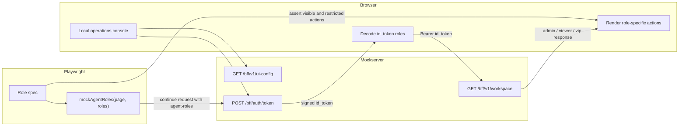
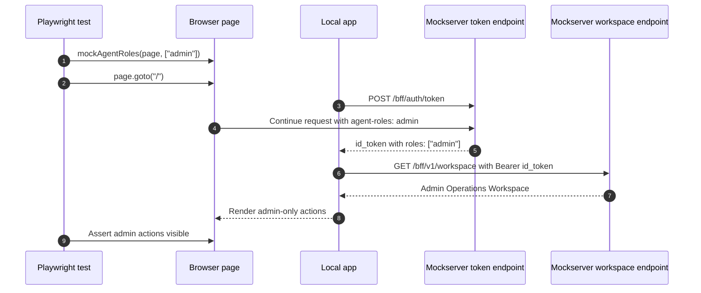
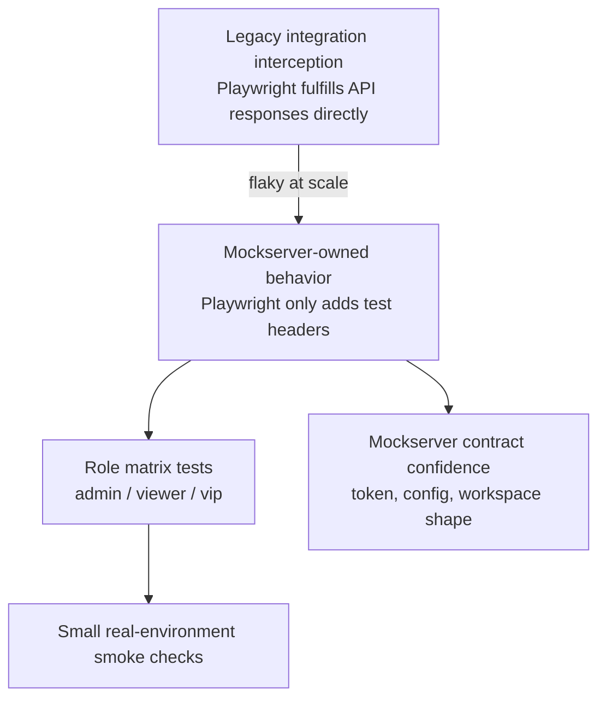

# Real Working Role-Based Playwright + Mockserver Project

This is a runnable project that demonstrates the same role-injection pattern as the sanitized real framework:

1. The local app loads UI config from the mockserver.
2. The app calls `/bff/auth/token`.
3. Playwright continues the token request with an `agent-roles` header.
4. The mockserver signs those roles into a JWT `id_token`.
5. The app calls a protected workspace endpoint with the token.
6. The UI renders different functionality for `admin`, `viewer`, and `vip`.

## High-Level Flow



## Request Sequence



## Testing Strategy



## Roles

| Role | Unique UI functionality |
|---|---|
| `admin` | User Admin Console, Security Override, Audit Log |
| `viewer` | Read-only Dashboard, Profile Search, Reports |
| `vip` | VIP Support Desk, Priority Override, Concierge Notes |

## Install

```bash
npm install
npx playwright install chromium
```

## Run Manually

Terminal 1:

```bash
npm run start:mockserver
```

Terminal 2:

```bash
npm run start:app
```

Open:

```text
http://127.0.0.1:5173
```

Manual browser usage defaults to `viewer` because Playwright is not adding `agent-roles`.

## Run Role Tests

```bash
npm run test:e2e
```

Expected result:

```text
admin, viewer, and vip projects all pass
```

## Run the Legacy Interception Comparison

This project also includes one comparison test for the earlier integration-style approach where Playwright fulfills API responses directly instead of letting the mockserver own backend behavior.

```bash
npm run test:legacy-interception
```

## Important Files

```text
app/
  public/app.js
  public/index.html
  public/styles.css
  server.mjs

mockserver/
  src/mock-server.js
  src/backend/index.js
  src/backend/endpoints/auth/token.js
  src/backend/endpoints/v1/ui-config.js
  src/backend/endpoints/v1/workspace.js

playwright/
  helpers/api-mock.ts
  pages/operations-console.page.ts
  pages/operations-console.assertions.ts
  tests/role-ui.spec.ts
  tests/feature-flags.spec.ts
  tests/legacy-network-interception.spec.ts
  playwright.config.ts
```
